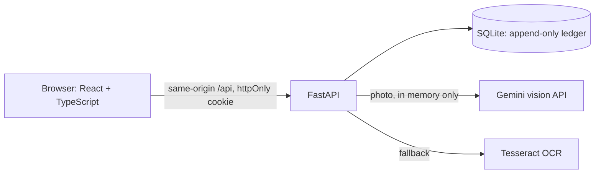

# Aurum

**A gold ledger for jewellery workshops.** Every gram that leaves the vault is recorded against a karigar and a job, and must come back as finished jewellery, scrap, filings or an agreed allowance. The owner can see where the gold is, per karigar, on any day.

- **Live demo:** https://aurum-ledger-1o99.onrender.com/
- **Repository:** https://github.com/MKN-Sai-Varun/aurum-ledger

> The demo runs on a free host. It sleeps when idle, so the first load can take 30 to 60 seconds, and its demo data resets whenever it restarts. Demo logins are in the submitted `deployment.md`.

## The problem it answers

Aurum is built for a Coimbatore jewellery chain with its own workshop and about 40 goldsmiths (karigars). Gold is issued on paper, wastage is worked out by hand, and month-end reconciliation takes six people three days. The client estimates unexplained loss of 0.4% of the gold issued, and wants it under 0.15%, with reconciliation down to half a day.

Aurum does not claim to have achieved those numbers. It supplies the controls that make them measurable: exact fine-gold arithmetic, an append-only ledger, per-job wastage checks, loss alerts that ask for a review, and a daily closing that compares the vault count with the records.

## What it does

| Area | What you can do |
|---|---|
| **Karigar master** | Keep karigars and their agreed wastage per item category. Only the finance head edits rates. |
| **Issue** | Record gold issued to a karigar. Fine weight is worked out on the server. A printable slip is produced and the running balance updates. |
| **Receipts** | Record finished pieces (with HUID), scrap and filings against a job. Allowed and outstanding wastage are shown as you go. |
| **Jobs** | See every job with issued, returned and outstanding fine gold, and close a job when the karigar is done. |
| **Ledger** | Any karigar's movements with a running balance, for any date range. |
| **Corrections** | The finance head reverses a mistaken entry with a written reason. Nothing is ever edited or deleted. |
| **Loss alerts** | Closed jobs and trends worth a closer look, phrased as items to review, never as accusations. |
| **Stock statement** | Gold in the vault, with karigars and at the refiner, for any day, with a CSV export. |
| **Old gold desk** | Record old gold bought from customers, tied to the exchange bill, with PAN and payment mode on high-value purchases. |
| **Photo reading** | Photograph a scale display or karat meter printout. The value is read, shown beside the photo, and confirmed by the clerk. |
| **Job aging** | Open jobs by age, with a sortable table and dated follow-up notes. |
| **Daily closing** | Opening balance, the day's movements, the expected closing vault, a counted-vault difference, and a closing snapshot with an audit entry. |
| **Karigar view** | A read-only phone page in Tamil and English showing the karigar's own balance, jobs and slips. |

The brief's core build is the karigar master, issue and receipt entries with wastage maths, running balances, loss alerts and the daily stock statement. The rest is optional depth.

## Rules that keep the numbers honest

- **Exact arithmetic.** Weights are integer milligrams and purity is integer hundredths of a percent. There is no floating point anywhere in the gold maths, and input is accepted as text only. The three sample rows from the brief are unit tests (120.000 g at 91.60% gives 109.920 g fine, and so on).
- **The server decides.** The browser previews figures, but the server recomputes every fine weight, value and balance. A request that tries to send its own fine weight is rejected.
- **Append-only ledger.** The ledger, audit log, stock entries, old gold records, closing snapshots and follow-ups are protected by database triggers that reject updates and deletes. A correction is a new reversing entry that points at the original.
- **History is stable.** A reversal is dated today and never changes an earlier statement. Each entry stores the agreed wastage that applied at the time.
- **Safe retries.** A save can carry an idempotency key, so a dropped connection followed by a second tap cannot record gold twice.

## How the AI part works

The brief asks for a reader of scale and karat-meter photos, with each reading shown beside its photo for the clerk to confirm, and a mismatch with a typed value blocking the save.

1. The clerk takes or chooses a photo. It is checked (size, type, dimensions), re-encoded in memory and stripped of metadata. **Photos are never stored**, only a fingerprint.
2. A vision model (Gemini) reads the value. If it is missing, busy or unsure, a local OCR reader (Tesseract) tries. If both fail, the clerk types the value, and the app never gets stuck.
3. Every reading passes through the same strict parsers as typed values, so impossible numbers are discarded.
4. The reading appears beside the clerk's photo and fills the field.
5. If the clerk's value differs from the reading, **saving is blocked** until they use the reading or give a written reason. The server enforces this, not just the screen.
6. Each reading is single-use, belongs to one clerk and expires after 30 minutes. Confirmations, corrections and reasons are recorded, and the finance head sees a correction rate.

The AI can be wrong, so it is advisory. It never saves anything by itself.

## Roles

| Role | Can do |
|---|---|
| **Issue clerk** | Issue, receipts, close jobs, old gold, photo readings. Read karigars, jobs and ledgers. |
| **Finance head** | Everything the clerk can read, plus karigar master edits, reversals, alerts, stock, aging, daily closing and voiding old gold. |
| **Karigar** | A read-only page of their own balance, jobs and slips. Every other endpoint is closed to them. |

Roles are read from the database on every request, not from the token.

## Architecture



One container serves both the API and the built frontend, so the sign-in cookie has a single origin.

| Layer | Choice |
|---|---|
| Backend | Python 3.12, FastAPI, SQLAlchemy 2, Pydantic 2 |
| Database | SQLite, with triggers for the append-only tables |
| Auth | Argon2id password hashes, signed JWT in an httpOnly, SameSite=Strict cookie |
| Frontend | React 19, TypeScript, Vite, plain CSS |
| AI | Gemini vision API, Tesseract fallback |
| Hosting | Docker image on Render |

## Security

- No secrets in the repository. Configuration comes from environment variables, and the app refuses to start in production with a weak signing secret.
- Passwords are hashed with Argon2id. Unknown usernames take as long to reject as real ones, and five failed sign-ins lock a username for 15 minutes.
- Every endpoint checks the caller's role on the server. A test walks the API schema and confirms a karigar login is refused everywhere except the karigar view.
- All inputs are validated, unknown fields are rejected, and uploads are limited in size, type and dimensions.
- PAN numbers are masked (`XXXXXX234F`) everywhere except the finance head's detail view, and never written to the audit log.
- In production the app sends a content security policy and HSTS, API documentation is switched off, and the container runs as a non-root user.

## Run it locally

You need Python 3.12 and Node 20 or newer. Tesseract is optional.

```bash
git clone https://github.com/MKN-Sai-Varun/aurum-ledger.git
cd aurum-ledger/backend

python3.12 -m venv .venv
source .venv/bin/activate            # Windows: .venv\Scripts\activate
pip install -r requirements-lock.txt

cp .env.example .env                 # then fill in the values below
python -m app.seed --reset           # loads the demo data
python -m uvicorn app.main:app --reload
```

In a second terminal:

```bash
cd aurum-ledger/frontend
npm ci
npm run dev                          # http://localhost:5173
```

### Configuration

Names only. Never commit values.

| Variable | Purpose |
|---|---|
| `APP_ENV` | `development` or `production` |
| `DATABASE_URL` | SQLite by default |
| `JWT_SECRET` | Signing secret, at least 32 characters in production |
| `DEMO_CLERK_PASSWORD`, `DEMO_FINANCE_PASSWORD` | Passwords for the seeded demo logins, 10 or more characters |
| `DEMO_KARIGAR_PASSWORD` | Optional, adds a demo karigar login |
| `GEMINI_API_KEY`, `GEMINI_MODEL` | Optional. Without a key, photo reading uses Tesseract, then manual entry |
| `AUTO_SEED` | `true` seeds an empty database at start-up (used on the free host) |

## Tests

```bash
cd backend
python -m pytest -q
cd ../frontend
npm run build && npm run lint
```

The backend has about 540 automated tests covering the gold maths, ledger rules, access control, photo-reading checks, retries and every report. They run without any `.env` or network access. The frontend is covered by the type-checked build and lint only, with no automated UI tests.

## API at a glance

| Group | Routes |
|---|---|
| Auth | `POST /api/auth/login`, `POST /api/auth/logout`, `GET /api/auth/me` |
| Master data | `GET/POST/PATCH /api/karigars`, `PUT /api/karigars/{id}/wastage/{category}`, `GET /api/categories` |
| Gold movements | `POST /api/issues`, `POST /api/receipts`, `GET /api/jobs`, `POST /api/jobs/{no}/close`, `POST /api/entries/{txn}/reverse` |
| Reports | `GET /api/karigars/{id}/ledger`, `/balance`, `GET /api/alerts`, `GET /api/stock/statement`, `/statement.csv` |
| Old gold | `GET/POST /api/old-gold`, `POST /api/old-gold/{no}/void` |
| Readings | `POST /api/readings`, `GET /api/readings/summary` |
| Operations | `GET /api/job-aging`, `GET /api/closing/day`, `POST /api/closing/close` |
| Karigar | `GET /api/me/summary` |

In development, interactive documentation is at `/docs`. It is switched off in production.

## Sample data

The database is seeded with invented data: six karigars, five item categories, 14 jobs, 39 ledger entries, old gold purchases, stock movements and two closed days. Murugesan S carries the three rows from the client's brief exactly. Selvam K has a loss that rises job by job, so the trend alert has something to find. Sample scale and karat-meter images for testing the photo reader are in [`samples/`](samples/), and `backend/scripts/make_sample_images.py` regenerates them. They are synthetic.

## Design

The client asked for minimal design with figures that are easy to read and hard to misread. Aurum uses an ivory page, one emerald action colour and coral reserved for items to review. Every gold figure uses a monospaced face with tabular numerals, so decimals align in every column. Layouts are mobile-first with 48 px tap targets, and motion is subtle and switches off for people who prefer reduced motion.

## Known limitations

- **The free host resets data** when it sleeps or restarts. A paid disk or a hosted Postgres would fix this, but the append-only triggers are SQLite syntax and would need porting.
- **No offline queue.** Drafts survive a refresh and saves are safe to retry, but the app does not save in the background while offline.
- **Closed days are not locked.** An entry backdated into a closed day is allowed and the day is flagged as changed.
- **No user management or password reset.** Accounts are created by the seed.
- **Sign-in lockout is in memory** and resets when the server restarts.
- **The Tamil text** on the karigar page is a draft that has not been reviewed by a native speaker.
- **Photo reading with a free AI tier:** only use synthetic images. I have not confirmed the provider's current terms for free-tier data.
- **The Tally export is a plain CSV**, because the brief does not give Tally's import format.
- **"Follow up" records a note.** It sends no message, because messaging is mocked in this build.

## Assumptions

The brief leaves several rules open, and each choice is recorded and labelled in the design document. The main ones: allowed wastage is a percentage of the fine gold issued on the job; a high-value old gold purchase means Rs 2,00,000 or more; and "deductions" means the weight of stones and other non-gold material.

## Project structure

```
backend/
  app/
    domain/        exact maths: gold, jobs, alerts, stock, old gold, aging, closing
    routers/       one module per area of the API
    readers/       photo checks, Gemini and Tesseract readers
    models.py      tables, constraints and append-only triggers
    seed.py        demo data
  tests/
frontend/
  src/
    pages/         one file per screen
    components/    dialogs, forms, photo panel
    lib/           API client, gold maths, drafts, translations
samples/           synthetic scale and karat-meter images
Dockerfile         one image for API and frontend
```

## Roadmap

Postgres with persistent data, a user-management screen for the finance head, locking of closed days, an offline queue, real Tally export and billing integration, and a native-speaker review of the Tamil text.